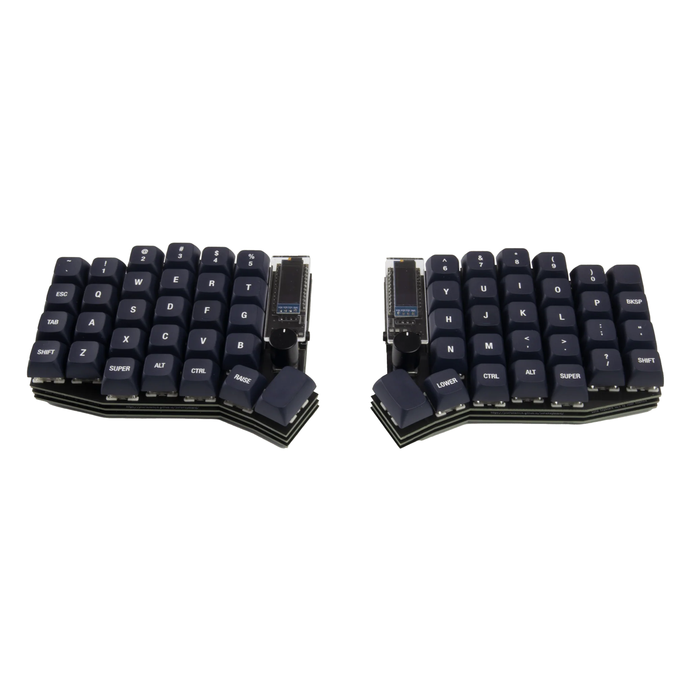
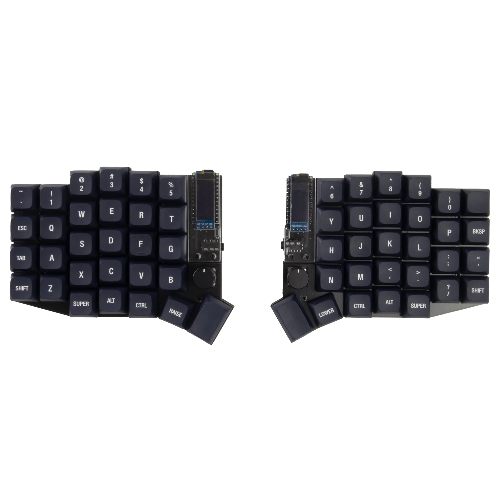
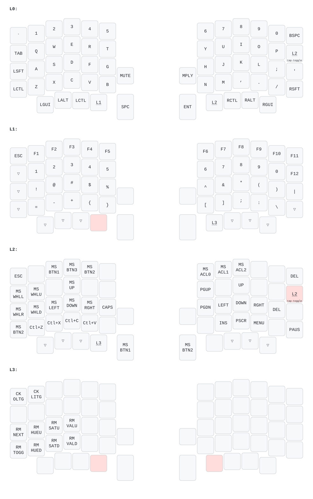
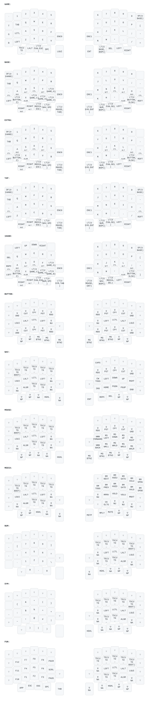

# keyboard-config

QMK and Vial configurations for my keyboard(s).

This repository contains:

- Keyboard firmware and configuration
- Keymaps
- Auto-generated keymap renders

---

## Table of Contents

- [Keyboards](#keyboards)
  - [Mechboards Sofle Pro](#mechboards-sofle-pro)

---

## Keyboards

### Mechboards Sofle Pro

Firmware: **QMK**, **Vial**

Photos

#### Keymaps

| Name                                                           | Firmware | Layers | Notes                                                             | Source                                                                                                                                                                                                |
|----------------------------------------------------------------|----------|--------|-------------------------------------------------------------------|-------------------------------------------------------------------------------------------------------------------------------------------------------------------------------------------------------|
| [`qwerty_vial`](#mechboards-sofle_pro-qwerty_vial)             | Vial     | 4      | Modified QWERTY shipped with the Sofle Pro by MechboardsLTD       | [MechboardsLTD: keymap](https://github.com/MechboardsLTD/vial-qmk/tree/84f9b6dd3e979cefe89271ca1356f9e3d6614998/keyboards/mechboards/sofle/pro/keymaps/default)                                       |
| [`jurf_miryoku`](#mechboards-sofle_pro-jurf_miryoku)           | QMK      | 12     | Based on [Miryoku](https://github.com/manna-harbour/miryoku)      | [Jurf: keymap](https://github.com/jurf/qmk_firmware/tree/ada946629a6947ad063d4b3735d90d8dd3c40730/keyboards/sofle/keymaps/jurf) · [blog post](https://jurf.github.io/2023/07/11/60-percent-miryoku/) |
| [`jurf_miryoku_vial`](#mechboards-sofle_pro-jurf_miryoku_vial) | Vial     | 12     | Vial port of [`jurf_miryoku`](#mechboards-sofle_pro-jurf_miryoku) | -                                                                                                                                                                                                     |

##### `qwerty_vial`

[Keymap Dir](./keyboards/mechboards/sofle/pro/keymaps/qwerty_vial)

Preview · Auto-generated

##### `jurf_miryoku`

[Keymap Dir](./keyboards/mechboards/sofle/pro/keymaps/jurf_miryoku)

Preview · Auto-generated

##### `jurf_miryoku_vial`

[Keymap Dir](./keyboards/mechboards/sofle/pro/keymaps/jurf_miryoku_vial)

Preview · Auto-generated

